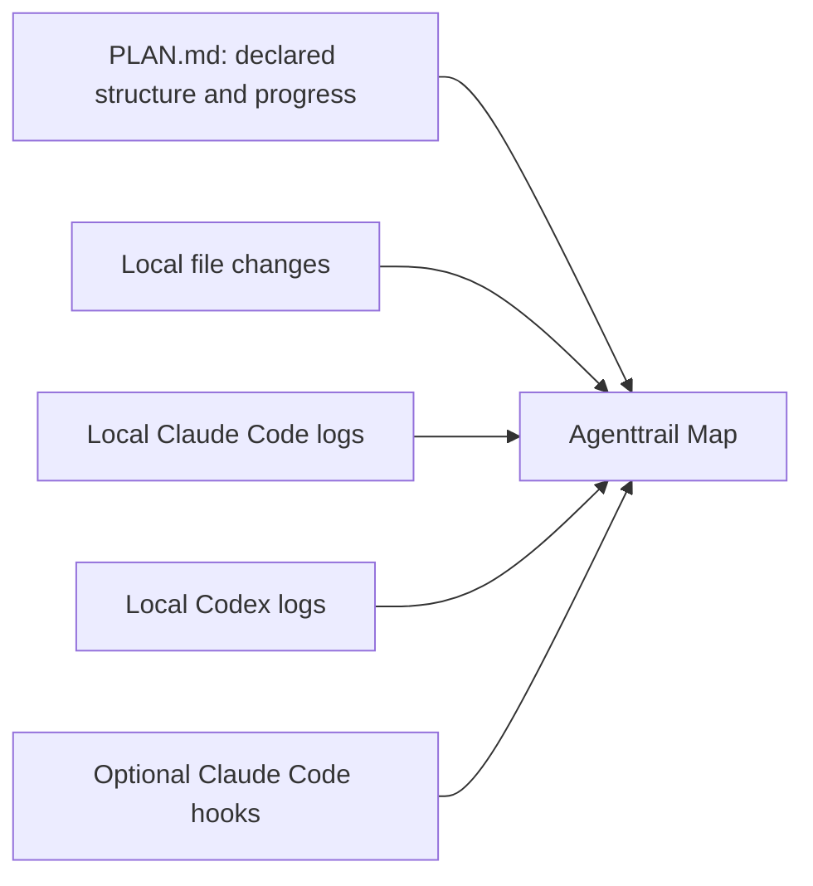

# How Agenttrail observes your agents

Agenttrail is a local observability tool for AI coding agents. It reads available evidence of their work and shows it on one live map. You continue to prompt, run and approve your agents in their existing tools.

It focuses on what is changing, which tasks are reported, who contributed and where attention is needed. It does not provide token billing, model-quality evaluations or a complete trace of every model request.

## Where the information comes from

`PLAN.md` describes durable project components and declared task status. File watching supplies evidence of edits, including changes to a component whose plan already says it is done. File changes alone do not identify an agent or prove that a task succeeded.

Provider logs and hooks add session identity, tool activity, lifecycle events and native tasks. Native tasks are the agent's temporary work list; they can change as a session progresses.

| Available evidence | Source | Notes |
| --- | --- | --- |
| Local file changes | File watcher | Any tool, no agent identity |
| Durable plan | `PLAN.md` | Component map and declared progress |
| Claude Code sessions and tools | Local logs; optional hooks | Hooks are live and can add a terminal id |
| Claude native task lists | Local logs; optional hooks | `TaskCreate`/`TaskUpdate`/`TaskGet`/`TaskList` and legacy `TodoWrite`, applied after the tool succeeds |
| Claude sub-agents | Local logs; optional hooks | Rows on the parent run, for the `Agent` tool and the older `Task` |
| Codex sessions and tools | Local logs | Experimental. `update_plan` lists when the log contains them |
| Cursor and other tools | None | File and plan observation only |

Automated checks run on Linux and macOS. Windows remains unverified. Cloud sessions need logs on this machine.

## How to read a run

Each run says what it knows in `evidence`:

- **Reported:** plan status, native tasks and lifecycle events supplied by the source.
- **Observed:** local file changes and recognised tool operations.
- **Inferred:** the component a run is pinned to, matched from `files:` globs.
- **Unknown:** unavailable native tasks, missing history or an unsupported event format. An empty list that was reported is different from a session that never reported one, and missing progress is never shown as a made-up percentage.

A run's `source` says how it reached Map: `hook`, `claude-log`, `codex-log`, or `hook+claude-log` when hooks and the log both contributed.

Map commits a native task change only after a recognised success. A failed, interrupted or unrecognised result keeps the last confirmed list. A task reported complete means only that; a deployment or published outcome needs its own evidence.

## Reading local logs

Map reads sessions working inside the watched repo, from logs touched in the last two hours, and at most the last 2 MiB of each file. Older history in a larger log is not read, and the run's evidence says `history: partial`, so a task list rebuilt from a partial log can be missing tasks created earlier. New sessions are found within about ten seconds, and new rows within about two. Read positions are saved, so a restart neither repeats nor loses events.

**Claude Code.** Map follows `CLAUDE_CONFIG_DIR` when it is set. A session counts row by row, as a hook does: if it moves into the repo partway through, only the rows inside the repo appear. A sub-agent is a row on its parent's run. Map does not read sub-agent transcripts, so their own tool calls and file edits are not attributed from logs. A sub-agent launched in the background has no running dot, because its log often never reports the end; a completion notice closes the row when there is one.

**Codex.** Map follows `CODEX_HOME` when it is set. Recent versions run tools inside an `exec` wrapper and report most of them as completed items, including file changes. Plans made inside that wrapper do not appear as an `update_plan` call, so those runs show their todos as unknown.

**Hooks and logs together.** One Claude session is one run, under its session id. Hooks are live, so a log row counts only if it is newer than the last hook heard, give or take the moment a relay takes to arrive for rows only the log reports. That lets the log fill in while Map was down or when hooks are not installed, without counting a call twice. Only hooks supply `terminalId`, and only when the terminal sets `HC_TERMINAL_ID`; log-only runs never have one. Hooks also let Map remind the agent at session start when the plan has fallen behind the code.

## The panel feed

`GET /panel` is a small, versioned, read-only summary, under the same local request checks as every other route: each run's status, open task, last tool, recent path, terminal id and evidence. A task is `reported`, a tool `observed` and a path `inferred`. The Herdr mod reads it to find the Maps on this computer, then draws from `/board-lite`. See [herdr/README.md](../herdr/README.md).

## What stays on your machine

Map binds to `127.0.0.1`. It requires no Agenttrail account, telemetry service, transcript upload or extra model call. The browser uses bundled graphics and system fonts.

The hook relay sends hook payloads to local Map services, and Map opens Claude and Codex logs read-only. The map can show shortened command text, search terms and other tool details. It saves recent activity, cycle summaries and log read positions under `~/.agenttrail`. It stores those shortened details, which can include the start of a command or prompt, but not whole prompts, replies, file contents or tool output, in files only your user can read. Check visible details before sharing screenshots or recordings.

Map answers only requests with a local `Host`, and rejects any foreign `Origin`. Setup and starting a board also need a token that the Map page receives when it loads; each running board has its own, stored at `~/.agenttrail/tokens/<port>.token` for sibling boards to use. The hook endpoint takes no token, so installed relays keep working; any local process can post events to it, but a web page cannot.

Normal watching does not edit your repo. Explicit setup creates plan and instruction files and a `.gitignore` entry, and offers Claude hooks; noninteractive `init` and the page's setup button assume yes. Map never sends agent prompts, approves provider actions or changes native task status.

[Start Map](../README.md#run-it-in-your-repo) · [Contribute](../CONTRIBUTING.md)
