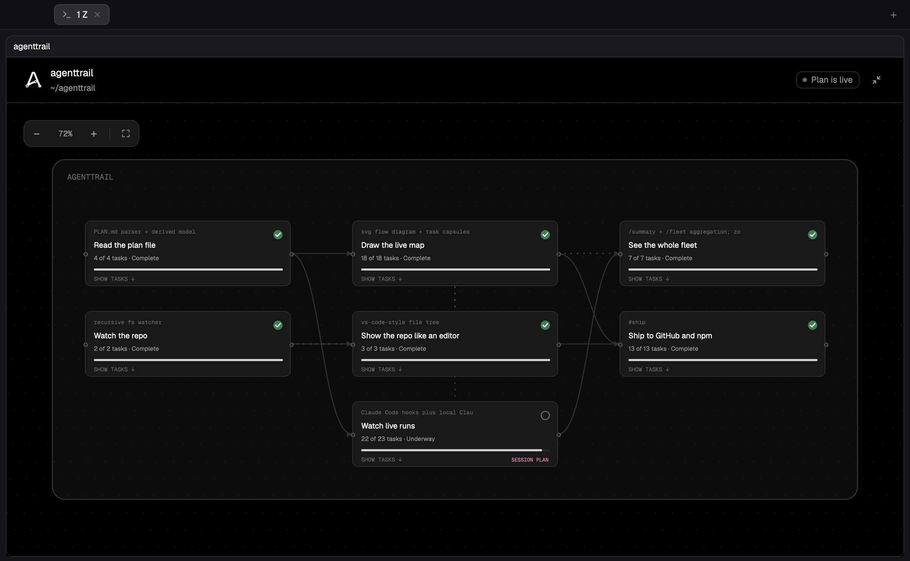

# Agenttrail for Herdr

A [Herdr](https://herdr.dev) mod: Agenttrail Map, drawn natively beside your agents. It shows the project as cards with connectors, each card's tasks and progress, and which card an agent is on right now. It opens as a panel on the right, expands to full size, and follows the repo of the focused terminal.



The picture is the real mod reading a real Map on this repository's own `PLAN.md`.

[`agenttrail/`](agenttrail/) is the shareable folder: `mods/agenttrail/`, the [`RECIPE.md`](agenttrail/RECIPE.md) another agent can build it from, and `preview.png`.

## Install

Ask the agent running in Herdr:

```text
Read ~/.config/herdr-app/AGENTS.md, then add this mod: https://github.com/sodiumsun/agenttrail/tree/main/herdr/agenttrail
```

By hand: copy `agenttrail/mods/agenttrail/` to `~/.config/herdr-app/mods/agenttrail/` and run `herdr-app check ~/.config/herdr-app/mods/agenttrail`. In a layout of your own it docks on the right the first time Herdr sees it. Herdr's shipped layouts (`main`, the default) don't take new docks, so open it beside your terminal there:

```sh
herdr-app do pane.split --direction right --mod agenttrail
```

## Use

- Run Map in a repo (`npx agenttrail`), or press **Start Map here** in the mod. The view follows the repo of the focused terminal and finds that repo's Map by itself.
- The graph comes from the repo's `PLAN.md`. With no plan it falls back to a simple view of branches and worktrees from git, labelled as inferred. That needs Map 0.4.0 or later.
- Click a card to open its tasks. Drag or scroll to pan, and hold cmd or ctrl while scrolling to zoom.
- The header button expands the panel to full size and collapses it again.

The mod is read-only. It talks only to Map on `127.0.0.1`, ports 5330 to 5344, and the only thing it starts is a Map terminal, when asked. It reads this computer only.
