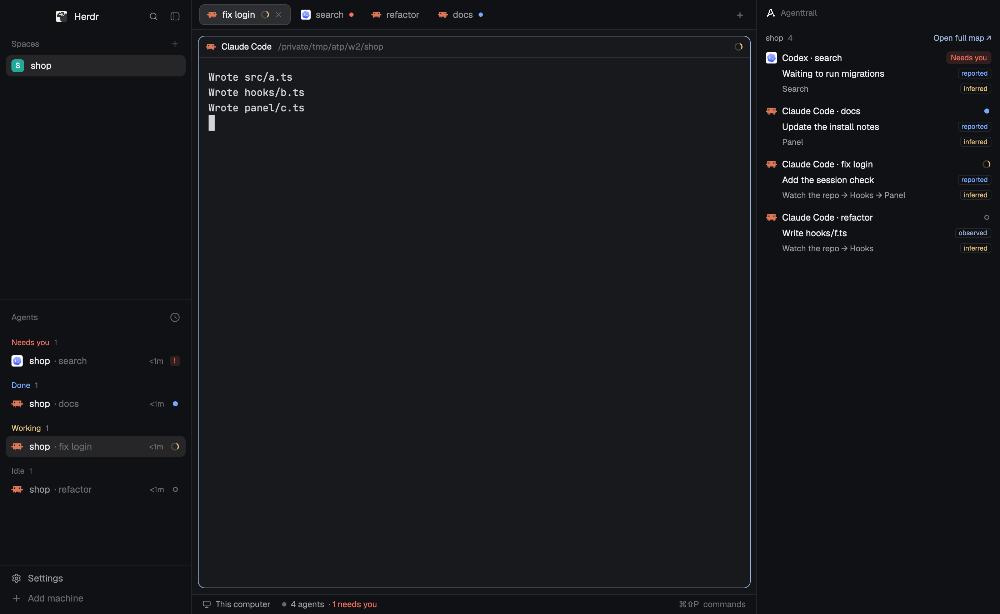

# Agenttrail

A panel beside your agents that shows which part of the project each one touched. Each row is an agent, its current task, its recent path through the project such as `Watch the repo → Hooks → Panel`, and its status, with every claim labelled reported, observed or inferred. Click a row to jump to that agent's terminal; **Open full map** opens Agenttrail Map in the browser. The panel only reads: it never writes to agents, plans or settings.

## What you see

One column, normally 340px wide, in the theme's `chrome` background. Text is 12.5px unless stated. Below 260px it switches to its narrow form. Top to bottom:

- **Header**, 36px high, 12px side padding: the Agenttrail mark at 14px (`mark-dark.svg` on dark, `mark-light.svg` on light, by `settings().dark`) and `Agenttrail` in 11.5px medium `dim`.
- **Sample banner**, only with sample data: `Sample data. Nothing here is real.` in 11px semibold `working` on `working` at 15% opacity, radius 6, 8px margin. While sample data came from the **Show sample** button, the header also shows **Back to live** in `accent`.
- **The list**, the rest of the height, scrolling. One group per repo with a running Map, sorted by project name:
  - **Group header**, 11px medium: the project name in `muted`, its row count in `dim`, and on the right `Open full map ↗` in `accent` (`Map ↗` when narrow).
  - **Note**, 11px `dim`, when something is missing: `No PLAN.md yet, so no path. Run agenttrail init in this repo.`; `This Map is too old for the panel. Restart it with the latest agenttrail.`; `This Map is newer than the panel. Update the panel.`; `Watching this repo. No agent sessions in the last two hours.`; or, when Map finds no hooks and no Claude or Codex log folder, `Watching this repo. No hooks or agent logs found yet. Map follows Claude and Codex logs by itself; agenttrail init --hooks-only adds terminal links.`
  - **Row**, 8px by 6px padding, radius 8, `hover` background when clickable. Text lines indent 23px under the icon:
    1. a 16px agent icon, the name (`Claude Code · fix login`: program and tab, or space when the tab is unnamed; `Claude · 3f2a`, provider and session start, when unlinked), and the status on the right;
    2. the task in `foreground`, labelled `reported`; else the last tool such as `Edit src/login.ts`, labelled `observed`; else `No open tasks`, labelled `reported`; else `No task reported` in 11.5px `dim` with no label;
    3. the path in 11.5px `muted`, labelled `inferred`, its oldest stops dropping first (shown as `… →`) so the end always fits; else `No project path yet`, or `No path without a plan`, in `dim`;
    4. when unlinked, 10.5px `dim`: `No terminal link`, `Terminal closed`, `Earlier session in this terminal` or `Can't tell which terminal`.
  - **Label**, 14px high, radius 4, `border` outline, 9.5px text: `reported` in `done`, `observed` in `accent`, `inferred` in `working`. Narrow: `R`, `O`, `I`, with the full word as a tooltip.
  - `3 older runs in the full map` in 10.5px `dim` under the rows when unlinked runs were folded away.
- **Map off**: `Map isn't running` in 12px semibold `foreground` and `Start it in a repo to see what each agent touched.` in `muted`; then one line per folder with agents in it, with its agent count and `Start Map here` in `accent` (`Start ↗` when narrow; `Starting…` in `dim` once pressed); then an outlined `Show sample` button, 24px high. With no agents, the focused terminal's folder is offered.
- **Footer**, only when agents run elsewhere, `border` line above, 10.5px `dim`: `2 agents on other machines aren't shown. This version reads this computer only.`

## How it behaves

- **Status**. A linked row shows Herdr's live status, drawn as in the shipped agents list: `working`, a 12px ring turning every 900ms in `working`; `blocked`, a `Needs you` badge in `blocked` (`!` when narrow); `done`, a 7px dot in `done`; `idle`, a 7px ring in `idle`. An unlinked row shows Map's status instead: active as working, idle as idle, or the words `Ended`, `Interrupted`, `Unknown` in `dim`. Map cannot know blocked or done, so an unlinked row never shows them.
- **Order**. Within a repo, blocked, done, working, idle, interrupted, unknown, ended; newest first within each.
- **Linking** a run to a terminal, in order:
  1. A terminal id links exactly. If that terminal is gone the row reads `Terminal closed` and never falls back to the repo. Two sessions in one terminal: the newest owns it, the older reads `Earlier session in this terminal`.
  2. With no id, a run active or idle in the last 30 minutes links by repo only when exactly one free local agent is in that repo, running the same program or an unknown one, and no other run wants that agent.
  3. Anything else stays unlinked. Two candidates either way round read `Can't tell which terminal`, on every run concerned.
- **Rows that aren't runs**: an agent in a watched repo with no run yet shows `Nothing seen from this agent yet` and is clickable. Sub-agent runs get no row. Unlinked runs silent for over 30 minutes fold into the count.
- **Click** a linked row: `agent.focus`, or `pane.focus` for a live terminal that reports no status. Unlinked rows and sample rows do nothing and have no hover.
- **Open full map**: the system browser at the Map's `http://localhost:<port>`.
- **Start Map here**: finds the folder's git root and opens a new tab named `Agenttrail Map` running `npx -y agenttrail@latest <repo> --no-open`. The panel notices the new Map by itself.
- **Polling**: Herdr's own data is live and never polled. Every 3 seconds the panel asks the Maps it knows; every fifth round, or while it knows none, it scans ports 5330 to 5344. With no Map, the wait doubles from 3 to 30 seconds. **Start Map here** resets it. A Map must miss two rounds before its group goes, and its agents then move to the `Start Map here` list.
- **Redraws** happen only when a feed really changed, not because its clock moved. Nothing moves but the working ring.
- Keys and hovers beyond the above: none.

## Built from

- **One mod**, `mods/agenttrail/`, no layout. `mod.json`: `{ "place": "right", "size": 340, "title": "Agenttrail" }`. Beside a terminal in any tab: `pane.split {direction: "right", mod: "agenttrail"}`.
- `main.js`: the view (`gpui-kit` `View`, `div`, `image`, `svg`; `gpui-base` `h_flex`, `v_flex`). One `cx.spawn` loop for the copy's life: `poller.tick()`, then `cx.sleep(3000)`. Width from `on_size_change` on the root. Colours from `theme()`.
- `feed.js`: `readBoard`, `Poller`, `delayAfter`. No Herdr imports; `fetch`, `sleep` and `now` are passed in.
- `link.js`: `linkRuns`, `repoOf`. Pure.
- `view.js`: `buildView`, `pathText`. Pure.
- `sample.js`: `SCENARIOS` (`all`, `off`, `old`, `noplan`, `nohooks`, `working`, `blocked`, `done`, `idle`, `nolink`, `shared`, `remote`). Made-up worlds that go through the same `buildView`.
- `mark-dark.svg`, `mark-light.svg`: the Agenttrail mark, unchanged. It also draws `icons/claude.svg`, `icons/codex.svg` and `mods/workspace-chrome/spinner.svg` from the app.
- **Props**, all optional: `sample` (a scenario name: always sample, no polling), `portBase` (default 5330, for a Map moved with `AGENTTRAIL_PORT_BASE`), `command` (argv that replaces the `npx` start, for a local checkout).
- **Herdr functions**: `agents`, `terminals`, `panes`, `focused`, `spaces`, `theme`, `settings`, `window`, `props`, `home`, `notify`, `run`, `exec`. **Commands**: `agent.focus`, `pane.focus`, `terminal.open`.
- **Programs**: `git rev-parse --show-toplevel` when Start Map is pressed; `open`, `xdg-open` or `cmd /c start` when Open full map is clicked; `npx` in a terminal.
- **Network**: `fetch` GETs to `http://127.0.0.1:<port>` only, for ports 5330 to 5344: `/panel`, and `/whoami` when `/panel` is a 404.
- **The feed**, `GET /panel`, schema 1, read-only, behind Map's local request boundary: `app`, `schema`, `project`, `repoPath` (resolved), `port`, `url`, `now`, `hasPlan`, `sources {hooks, claudeLogs, codexLogs}`, `runs[]`. A run: `id`, `agent`, `provider`, `source`, `status`, `terminalId`, `parentId`, `cwd`, `startedAt`, `lastEventAt`, `task {text, state}`, `tool {name, detail, running}`, `path [{id, title, at}]` (at most 5, oldest first), `evidence {status, task, tool, path, partial}`.

## Watch out

- The mod reaches only loopback Maps, runs the programs above, and reads no files. `npx` is the one thing that reaches the internet, and only after someone presses **Start Map here**.
- It needs a Map with `/panel`. Anything older shows the too-old note. `--no-open` matters twice: a Map in a terminal would otherwise open a browser, and would stop at its first-run setup prompt in a repo with no plan.
- `exec` stops after 30 seconds, so never start Map with it. Use `terminal.open`.
- Herdr's `fetch` runs nearly one at a time, about 250ms each, and has no timeout. A 15-port scan takes about 1.7 seconds. With a 1.5-second budget per port a Map was missed; the budget is 4 seconds.
- Terminal ids need Map's hooks, installed from a version that sends `HC_TERMINAL_ID`. Log-only sessions have no id, so two of them in one repo stay unlinked. That is the design: never guess.
- `panes()` gives a terminal's real folder. On macOS `/tmp` is a symlink, so Map's feed sends the resolved repo path; comparing to the unresolved one matches nothing.
- `done` only appears for an agent that was working and finished while nobody looked. A program that reports `done` while shown stays `idle`.
- Herdr's shipped layouts don't take a new mod's dock (0.1.12). On `main`, open it with `pane.split`.
- Each shown copy polls on its own, and hidden copies keep polling. One copy is the intended setup.
- Path titles are PLAN.md's component titles, and a file matching several components visits each. The path is inferred, so it is labelled.
- This machine only. An agent elsewhere is counted in the footer, never linked, even at the same path.

## Done when

- `herdr-app check ~/.config/herdr-app/mods/agenttrail` passes.
- `npm test` in the Agenttrail repository passes.
- With no Map running, the panel says `Map isn't running`, lists folders with agents, and **Show sample** shows the banner and rows that do nothing when clicked.
- **Start Map here** opens an `Agenttrail Map` tab, and within a few seconds the repo's group replaces the message.
- An agent with Map's hooks shows its task, path and live status, and clicking its row focuses its terminal.
- Two sessions without terminal ids and two agents in one repo both read `Can't tell which terminal`, and neither is clickable.
- One session without an id and one agent in a repo link, and clicking focuses it.
- Stopping a Map removes its group within about 6 seconds and offers `Start Map here` for its agents.
- A Map with no `/panel` shows the too-old note.
- Below 260px wide, labels become `R`, `O`, `I`, the path keeps its end, and `Map ↗` replaces `Open full map ↗`.
